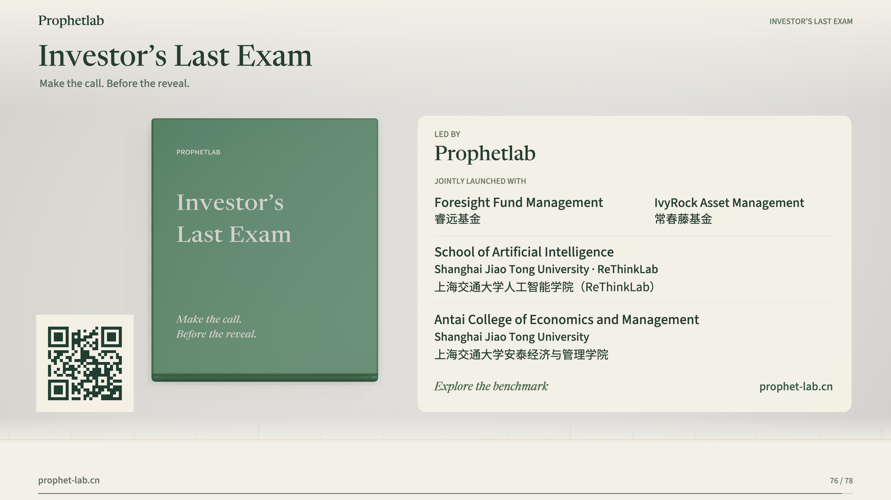

# Investor’s Last Exam

### 不看见未来，AI 能做好股票投资研究吗？

**在结果揭晓之前，作出判断。**

[项目主页](https://prophet-lab.cn/benchmarks/investor-last-exam-v1/) · [English](README.md) · [评测口径](docs/evaluation.md) · [完整结果 CSV](results/README.md)

**86 道任务 · 11 个参评系统 · 343 万余个文档版本**

## 78 秒了解 Investor’s Last Exam

**[▶ 在线播放视频](https://prophetlab.github.io/Investor-Last-Exam/)** · 1080p · 英文旁白与中英双语字幕 · [下载 MP4](https://github.com/Prophetlab/Investor-Last-Exam/raw/refs/heads/main/docs/assets/investors-last-exam-78s.mp4)

通过时间冻结环境、Tesla 与 Nebius 的研究任务流程，以及 11 个模型的评测结果，快速了解 ILE。

**Investor’s Last Exam（ILE）** 是由真实买方投资人和基金经理主导设计的股票投资研究基准。模型需要在严格限定的历史信息环境中，调查证据、建立预测、形成投资判断，并根据新信息更新观点。评测既检查分析过程，也在适用任务中对照后续实际结果。

一份逻辑完整的研报，能否支持准确的预测？一个看似合理的预测，能否转化为有价值的投资判断？ILE 希望把这条链路中的能力与失败原因分开测量。

项目由 **Prophetlab** 领衔，联合 **睿远基金、IvyRock Asset Management、上海交通大学人工智能学院（ReThinkLab）和上海交通大学安泰经济与管理学院**推出。

## ILE 的三个核心设计

### 1. 严格冻结工具可访问的历史信息

在提示词或搜索词里写上日期，并不保证模型看不到未来。旧页面可能被更新，搜索结果也可能直接返回后来公布的答案。

ILE 以版本化资料库约束信息可用性。截至论文采用的 **2026 年 10 月 15 日**快照，资料库包含 **3,430,336 个文档版本、九类来源、约 1.52 TB 资料**，覆盖财务报告、结构化报表、业绩电话会、投资者材料、公司事件、分析师预期、研究报告、机构持仓与新闻，另有结构化市场数据支持价格、收益率和波动率分析。

搜索、阅读、下载、缓存结果和结构化数据查询遵循同一个截止时点与授权边界。后续披露、参考分析和评分标准保留在独立评估环境中。这里控制的是工具提供的证据版本，**不代表清除了模型预训练中可能获得的未来知识**。

### 2. 围绕专业研究交付物出题

最新版共 **86 道任务：78 道公司研究任务＋8 道市场任务**。前五个类别包含二十个专业子类型，综合研究则要求把这些能力连接起来。

| 类别 | 主要交付物 | 题量 |
|---|---|---:|
| 发现与界定问题 | 机会筛选、催化剂分析、可检验的投资假设 | 10 |
| 研究与证据 | 可比历史数据、财务事实与口径核对 | 13 |
| 预测与建模 | 经营指标预测、收入利润桥接、同业信号推演 | 13 |
| 评估与决策 | 估值、隐含预期、投资行动 | 14 |
| 跟踪与更新 | 事件影响、预测修正、投资假设更新 | 17 |
| 综合研究 | 连接预测、投资立场、风险与观点变化条件的报告 | 11 |
| 市场交易任务 | 价格预测、未来收益率或波动率排序 | 8 |
| **合计** | | **86** |

### 3. 把评分连接到证据、计算和金融判断

专家主导的问题与评分标准，将每项要求连接到来源、计算、假设和财务依赖关系。评测检查结果、证据、金融逻辑、计算、勾稽一致性、决策一致性与不确定性，并单独报告实际预测表现和模拟投资收益。

## 两个具体案例

### 特斯拉：分析自洽，预测仍可能落空

**O80** 要求根据 **2026 年 6 月 22 日**之前的信息，预测特斯拉第二季度交付量、GAAP 收入与 GAAP 汽车业务毛利率。

GPT-6 Astra、Claude Opus 5.5 和 Qwen 3.8 Max 都拿到了全部 **50 分分析支持分**，但在该题的 **50 分预测结果分**上均得零分。三个模型都低估了交付量和收入、高估了汽车业务毛利率，误差均超过相应指标的零分阈值。

计算桥接和投资建议可以保持一致，但未来需求、价格或成本假设仍可能偏离现实。ILE 同时检验分析支持与预测结果。上述分数是这道题的案例结果，不是模型在整个基准上的表现。

### AEP：经营现金流增加，为什么更缺钱？

**N27** 要求结合 AEP 的 2026 年第二季度报告，比较 2025 年与 2026 年上半年的资金状况，并解释燃料成本回收的变化。

| 单位：百万美元 | H1 2025 | H1 2026 | 变化 |
|---|---:|---:|---:|
| 经营现金流入 | 2,671 | 3,421 | +750 |
| 投资现金支出 | 5,347 | 6,602 | +1,255 |
| 融资前资金缺口 | 2,676 | 3,181 | **+505** |

11 个系统都找到了八项披露数据，并完成两项现金流恒等式核对。但只有 **5 个系统**算对两个期间的资金缺口，**5 个系统**在综合资金需求结论这一组标准上获得满分，**3 个系统**区分了净递延燃料调整与燃料回收总额。

找到数字之后，还需要判断现金从哪里来、用到哪里，以及改善能否持续。

## 各模型评测结果

以下采用论文默认的 **最终答案评分（answer-based）** 口径，各任务等权。语义标准由 GPT-6 Astra 评分，数值要求采用确定性检查。三列均为 **0—100 分**，不能解释为预测正确率。

| 模型 | 综合评测 | 预测与建模 | 实际预测结果 |
|---|---:|---:|---:|
| GPT-6 Astra | **68.1** | 52.5 | 37.7 |
| Claude Opus 5.5 | 66.9 | **52.6** | 37.6 |
| DeepSeek V4.1 Flash | 63.0 | 45.8 | **40.3** |
| GLM 5.3 | 62.3 | 46.6 | 34.1 |
| Qwen 3.8 Max | 62.1 | 49.9 | 34.5 |
| Hunyuan 4 Preview | 60.4 | 50.5 | 37.9 |
| DeepSeek V4 Pro | 59.3 | 45.6 | 35.0 |
| Kimi K3 | 58.2 | 41.0 | 37.2 |
| Step 5 Preview | 55.1 | 43.9 | 31.2 |
| Qwen 3.8 27B | 54.6 | 44.5 | 32.8 |
| Ling 3.0 Flash | 42.6 | 38.5 | 33.4 |

来源：论文表 3、表 13。预测与建模是该任务类别的完整得分；实际预测结果是表 13 的 Combined 列，汇总适用任务中点预测、区间、概率和市场结果等数值标准的得分。二者评价范围不同。

- **GPT-6 Astra 综合领先**，但其研究与证据类别得分为 78.9，预测与建模为 52.5。
- **DeepSeek V4.1 Flash 的实际预测结果得分领先**，为 40.3。
- **DeepSeek V4 Pro 在市场交易类别领先**，为 64.6。

完整结果：[答案质量各维度](results/answer_quality.csv)、[任务类别与 API 成本](results/task_categories.csv)、[实际预测结果分项](results/forecast_outcomes.csv)。

## 将基本面预测转化为投资信号，收益如何？

论文还进行了独立于八道市场任务的**预测驱动模拟投资实验**：将模型预测与当时可获得、已归档的分析师预期比较，再按固定规则建立多头、空头或现金头寸。

实验覆盖 **2026 年 3—8 月、20 个任务机会、11 家公司和 13 次披露事件**。各机会分配初始资金的 1/20，不加杠杆，不重新分配闲置资金，并计入交易及借券成本。

| 模型／对照策略 | 模拟累计收益率 | 相对始终做多的超额收益（百分点） | 最大回撤 |
|---|---:|---:|---:|
| Hunyuan 4 Preview | **+8.50%** | **+7.32** | 2.72% |
| DeepSeek V4.1 Flash | +7.98% | +6.80 | 3.65% |
| GPT-6 Astra | +7.18% | +6.00 | **1.50%** |
| Kimi K3 | +7.15% | +5.97 | 4.02% |
| Claude Opus 5.5 | +6.39% | +5.21 | 2.94% |
| GLM 5.3 | +6.19% | +5.01 | 3.53% |
| Qwen 3.8 27B | +5.20% | +4.02 | 1.90% |
| DeepSeek V4 Pro | +3.64% | +2.46 | 2.03% |
| Ling 3.0 Flash | +2.51% | +1.33 | 2.64% |
| Qwen 3.8 Max | +1.67% | +0.48 | 2.05% |
| 始终做多 | +1.18% | +0.00 | 7.63% |
| 始终做空 | −2.27% | −3.45 | 8.86% |

来源：论文表 4、附录 I.2，数值保留论文的四舍五入结果。每次入场、退出各计 10 个基点成本，空头另计年化 3% 借券成本；收益未年化，不含现金分红。**Step 5 Preview 仅有三个可用预测，未纳入组合比较，不能按零收益处理。**

Hunyuan 在这一回溯样本中领先。Kimi 的综合评测分低于 Opus，模拟收益率却高于后者。研究质量、预测结果与投资收益体现了不同能力，也受到预测覆盖、信号相对市场预期的方向及后续股价变化影响。

这些是有限样本下的历史模拟，不是实盘业绩，也不能直接推导为未来可持续收益。完整规则见[评测说明](docs/evaluation.md#forecast-driven-investment-simulation)，数据见[收益 CSV](results/investment_returns.csv)。

## 当前仓库内容

当前仓库提供中英文项目介绍、评测与投资模拟口径，以及依据 2026 年 10 月 27 日提供的论文版本整理的机器可读结果表。

**本仓库尚不包含可运行的评测程序、完整任务数据或数据访问服务，也不分发完整金融资料库、私有参考分析及评分标准。** CSV 用于查看论文报告的结果，不能替代完整实验复现。

项目详情请访问[项目主页](https://prophet-lab.cn/benchmarks/investor-last-exam-v1/)，数据访问或复现问题可通过 [Issues](https://github.com/Prophetlab/Investor-s-Last-Exam/issues) 联系项目团队。

## 引用与许可

论文标题：*Investor’s Last Exam: Can AI Agents Do Equity Investment Without Seeing the Future?*

BibTeX 见[英文 README](README.md#citation)。当前仓库尚未指定开源许可证；论文、金融来源资料、未来代码与数据发布可能适用不同条款，仓库不授予底层金融资料库的再分发权。
